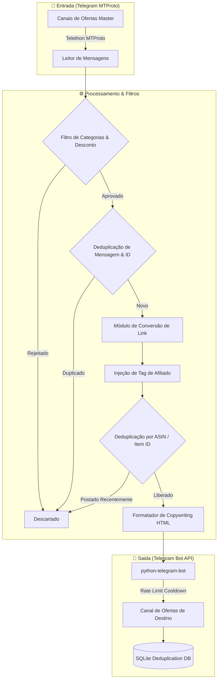

# RadarJarbis — Bot Automatizado de Afiliados 🤖

O **RadarJarbis** é um motor de automação profissional para canais de ofertas e afiliados no Telegram. Ele monitora canais de ofertas de entrada (masters), filtra produtos de acordo com nichos e regras de desconto, converte links para as tags de afiliados do operador e publica os posts formatados no canal de destino.

O projeto suporta **dois bots independentes e dedicados**:
1. **Bot Amazon (`src.bot`)**: Converte links de produtos e encurtadores da Amazon (`amzn.to`, `amazon.com.br`, `a.co`), deduplica por ASIN/preço, extrai dados de parcelamento, selo Prime e cupons.
2. **Bot Mercado Livre (`src.bot_meli`)**: Converte URLs do Mercado Livre (`mercadolivre.com.br`, `produto.mercadolivre.com.br`), resolve encurtadores e gera links de afiliado oficiais `meli.la`.

---

## 🏗️ Arquitetura do Sistema



---

## ⚡ Início Rápido

Para um guia passo a passo completo voltado a novos usuários e contas de terceiros, consulte o **[Guia de Instalação e Configuração Detalhado](docs/SETUP_GUIDE.md)**.

### 1. Clonar e Instalar Dependências
```bash
git clone https://github.com/SEU_USUARIO/radar-jarbis.git
cd radar-jarbis

python3 -m venv .venv
source .venv/bin/activate
pip install -r requirements.txt
```

### 2. Configurar Variáveis de Ambiente
Copie o template de variáveis de ambiente e preencha com suas credenciais:
```bash
cp config/.env.example .env
```

Campos obrigatórios:
* `TELEGRAM_API_ID`: ID da sua aplicação Telegram (MTProto).
* `TELEGRAM_API_HASH`: Hash da sua aplicação Telegram (MTProto).
* `TELEGRAM_BOT_TOKEN`: Token do bot fornecido pelo [@BotFather](https://t.me/BotFather).
* `SOURCE_CHANNEL_IDS`: IDs numéricos ou usernames dos canais de origem (separados por vírgula).
* `OUTPUT_CHANNEL_ID`: Canal de destino onde o bot postará as ofertas (ex: `@meucanal`).
* `AMAZON_AFFILIATE_TAG`: Sua tag de associado Amazon (ex: `seunome-20`).
* `MELI_AFFILIATE_TAG` / `MELI_USER_ID`: Configurações de afiliado do Mercado Livre.

### 3. Execução

#### Executar o Bot da Amazon:
```bash
.venv/bin/python -m src.bot
```

#### Executar o Bot do Mercado Livre:
```bash
SESSION_NAME=session_meli .venv/bin/python -m src.bot_meli
```

---

## ⚙️ Execução em Segundo Plano (Systemd no Linux)

Modelos de serviços prontos com proteções de segurança embutidas:
- **Amazon**: [`radar-jarbis.service.example`](radar-jarbis.service.example)
- **Mercado Livre**: [`radar-jarbis-meli.service.example`](radar-jarbis-meli.service.example)

```bash
# Copiar modelos e ajustar caminhos/usuário
cp radar-jarbis.service.example radar-jarbis.service
cp radar-jarbis-meli.service.example radar-jarbis-meli.service

# Instalar no systemd
sudo cp radar-jarbis*.service /etc/systemd/system/
sudo systemctl daemon-reload
sudo systemctl enable --now radar-jarbis.service
sudo systemctl enable --now radar-jarbis-meli.service
```

Comandos de gerenciamento:
```bash
# Acompanhar logs em tempo real
sudo journalctl -u radar-jarbis.service -f -n 50
sudo journalctl -u radar-jarbis-meli.service -f -n 50

# Reiniciar serviço
sudo systemctl restart radar-jarbis.service
```

---

## 🧪 Testes Automatizados

O projeto conta com mais de 130 testes cobrindo filtros de nicho, extração de preços, copywriting, injeção de tags e deduplicação concorrente:

```bash
# Executar todos os testes
.venv/bin/python -m unittest discover -s tests -v

# Validar sintaxe Python em todo o projeto
.venv/bin/python -m compileall -q src tests
```

---

## 📚 Documentação Adicional

* 📖 **[Guia de Instalação e Configuração para Terceiros](docs/SETUP_GUIDE.md)**: Passo a passo para configurar contas, canais e bots.
* 🤖 **[Instruções para Agentes e IAs (AGENTS.md)](AGENTS.md)**: Especificações técnicas de arquitetura, regras de negócio e restrições.
* 📊 **[Guia de Monitoramento Zabbix / Prometheus](docs/ZABBIX_MONITORING.md)**: Templates e endpoints de métricas em tempo real.
* 🔧 **[Manual de Troubleshooting](docs/MANUAL_TROUBLESHOOTING.md)**: Resolução de dúvidas operacionais e diagnósticos.
* 🗄️ **[Documentação do Banco de Dados](docs/database.md)**: Estrutura do SQLite de deduplicação e modelo de migração.

---

## 🔒 Segurança e Privacidade

- **Proteção de Credenciais**: Arquivos `.env`, `*.session` (sessões Telethon) e bancos `*.db` estão listados no `.gitignore` e nunca devem ser versionados.
- **Processamento em Memória**: Mídias (fotos e vídeos) são baixadas em buffer de memória (`io.BytesIO`) e não são persistidas em disco.
- **Isolamento de Processos**: Os bots da Amazon e do Mercado Livre utilizam arquivos de sessão e bancos de deduplicação isolados, prevenindo concorrência indesejada.