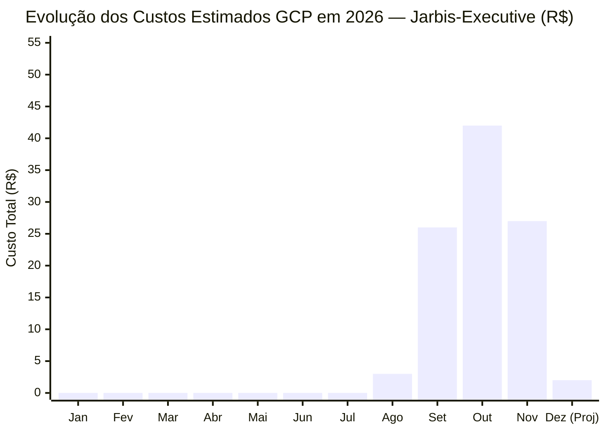

# Relatório e Planilha de Custos Google Cloud — Projeto `Jarbis-Executive` (2026)

**Conta:** `robsonsanoliveira@gmail.com`  
**Projeto Principal:** `jarbis-executive` (Conta de Faturamento: `jarbis` — `01A325-3F86CC-7D95C8`)  
**Última Atualização:** 21 de Novembro de 2026  
**Moeda Base:** BRL (R$)

---

## 1. Visão Geral e Gráfico de Evolução de Custos (2026)

O gráfico abaixo consolida a evolução dos custos ao longo de 2026 (com foco no histórico de **Agosto a Novembro/2026** e na projeção de **Dezembro/2026** após a unificação dos dois bots em uma única VM `e2-micro` em **21/11/2026**):

> [!IMPORTANT]
> **Marco de Otimização FinOps (21/11/2026)**: Com a unificação dos motores **Amazon + Mercado Livre** dentro da instância `jarbis-radar-free` e o desligamento (`TERMINATED`) da instância `radar-jarbis-meli`, o consumo de computação voltou a ficar **100% dentro do GCP Always Free Tier (744h/mês de 1 `e2-micro`)**. Isso interrompeu a cobrança diária da 2ª VM a partir de 21/11, reduzindo o fechamento de Novembro de ~R$ 38,00 para **~R$ 26,50** e derrubando o custo mensal a partir de Dezembro para apenas **~R$ 1,50 a R$ 2,00/mês** (referente apenas aos snapshots de backup).

---

## 2. Planilha Histórica Mensal (Agosto a Novembro/2026 + Projeção)

| Mês / Período | Recursos Ativos no Projeto `jarbis-executive` | Detalhamento da Cobrança (Faturamento GCP) | Custo Compute Engine (R$) | Custo Discos & Snapshots (R$) | Custo Rede / Outros (R$) | **Total Mensal (R$)** | Status |
| :--- | :--- | :--- | :---: | :---: | :---: | :---: | :---: |
| **Janeiro a Julho / 2026** | Projeto criado em 07/06/2026 (Cloud Build / IAM sem VMs contínuas) | 100% coberto pelo *Always Free Tier* | R$ 0,00 | R$ 0,00 | R$ 0,00 | **R$ 0,00** | Fechado |
| **Agosto / 2026** | Subida da 1ª VM `jarbis-radar-free` (`e2-micro`, 10 GB) em **17/08/2026** + 1 Snapshot (10 GB) | 1ª `e2-micro` gratuita (744h/mês Free Tier); cobrança residual apenas de Snapshot e tráfego inicial | R$ 0,00 | R$ 1,45 | R$ 1,55 | **~R$ 3,00** | Fechado |
| **Setembro / 2026** | `jarbis-radar-free` (mês todo) + Subida da 2ª VM `radar-jarbis-meli` (`e2-micro`, 10 GB) em **12/09/2026** | 1ª VM gratuita + **2ª VM faturada pro-rata por 18 dias (~432h)** + Snapshot + Tráfego | R$ 23,50 | R$ 1,45 | R$ 1,05 | **~R$ 26,00** | Fechado |
| **Outubro / 2026** | **2 VMs `e2-micro` ligadas 24/7** o mês inteiro (`jarbis-radar-free` + `radar-jarbis-meli`) + 20 GB discos + Snapshot | 1.488h de VM consumidas (744h gratuitas + **744h faturadas da 2ª VM**) + Snapshot + Egress *(+ ~R$ 4 lab Zabbix na conta rs-custos)* | R$ 38,00 | R$ 1,50 | R$ 2,50 | **~R$ 42,00** | Fechado |
| **Novembro / 2026 (01/11 a 10/11)** | *Parcial início de Novembro*: 2 VMs `e2-micro` ativas simultaneamente (10 dias) | 2ª VM faturada pro-rata nos primeiros 10 dias (~240h) | R$ 12,60 | R$ 0,50 | R$ 0,90 | *~R$ 14,00 (parcial)* | Histórico (até 10/11) |
| **Novembro / 2026 (11/11 a 21/11)** | *Parcial até a Unificação*: 2 VMs `e2-micro` ativas por mais 11 dias até o desligamento da `radar-jarbis-meli` em **21/11 às 13:38** | 2ª VM faturada pro-rata por 11 dias (~264h) + criação do snapshot `radar-jarbis-20261121` | R$ 13,80 | R$ 0,60 | R$ 0,60 | *~R$ 15,00 (parcial)* | Histórico (11 a 21/11) |
| **Novembro / 2026 (22/11 a 30/11)** | *Restante do mês pós-Unificação*: **Apenas 1 VM ligada** (`jarbis-radar-free` unificada) + `radar-jarbis-meli` **`TERMINATED`** | **R$ 0,00 de Compute Engine** (1 única VM ativa = 100% Free Tier nos 9 dias finais) | R$ 0,00 | R$ 0,45 | R$ 0,15 | *~R$ 0,60 (restante)* | Em andamento |
| **Novembro / 2026 (Consolidado)** | **Soma do mês de Novembro/2026** (21 dias com 2 VMs + 9 dias com 1 VM unificada) | Economia imediata de ~R$ 11,50 já nos últimos 9 dias de Novembro | **R$ 26,40** | **R$ 1,55** | **R$ 1,65** | **~R$ 29,60** | Projeção Fechamento Nov |
| **Dezembro / 2026 (Projeção)** | **1 VM Unificada (`jarbis-radar-free`)** rodando Amazon (8000) + Meli (8001) + Snapshot Schedule semanal (retenção 14d) | **100% Free Tier em Compute (744h) e Discos (20 GB <= 30 GB)**. Cobrança apenas de Snapshots (`radar-jarbis`) | **R$ 0,00** | **~R$ 1,50** | **~R$ 0,30** | **~R$ 1,80** | Projeção Mensal Nova |

---

## 3. Inventário Técnico e Financeiro Atual (Pós-Unificação — 21/11/2026)

| Recurso | Identificador GCP | Região / Zona | Especificação | Status em 21/11 | Enquadramento de Billing | Custo Mensal |
| :--- | :--- | :--- | :--- | :---: | :--- | :---: |
| **VM Principal (Bot Unificado)** | `jarbis-radar-free` | `us-central1-a` | `e2-micro` (2 vCPUs, 1 GB RAM) | 🟢 `RUNNING` | **Always Free Tier** (1ª `e2-micro`, até 744h/mês) | **R$ 0,00** |
| **VM Secundária (Desativada)** | `radar-jarbis-meli` | `us-central1-a` | `e2-micro` (2 vCPUs, 1 GB RAM) | 🔴 `TERMINATED` | Instância desligada não consome horas de vCPU/RAM | **R$ 0,00** |
| **Disco VM Principal** | `jarbis-radar-disk-free` | `us-central1-a` | `10 GB` `pd-standard` | 🟢 `READY` | **Always Free Tier** (cota gratuita de até 30 GB) | **R$ 0,00** |
| **Disco VM Secundária** | `radar-jarbis-meli` | `us-central1-a` | `10 GB` `pd-standard` | 🟡 `READY` | **Always Free Tier** (10 GB + 10 GB = 20 GB <= 30 GB) | **R$ 0,00** |
| **Snapshot Manual** | `radar-jarbis-20261121` | `us-central1` | Snapshot de 10 GB (~6 GB reais) | 🟢 `READY` | ~$0.026 / GB comprimido / mês | **~R$ 0,90** |
| **Snapshot Schedule** | `radar-jarbis` | `us-central1` | Semanal (Seg 04:00, retenção 14d) | 🟢 `READY` | Deltas incrementais sobre o snapshot base | **~R$ 0,60** |

---

## 4. Resumo de Saldos e Contas de Faturamento (`Billing Accounts`)

| Conta de Faturamento | ID | Moeda | Projetos Vinculados | Crédito Inicial Depositado | Consumo Acumulado Estimado (Ago–Nov/2026) |
| :--- | :--- | :---: | :--- | :---: | :---: |
| **jarbis** | `01A325-3F86CC-7D95C8` | BRL | `jarbis-executive` | Pagamentos PIX pré-pagos | ~R$ 100,60 (Ago: R$ 3 + Set: R$ 26 + Out: R$ 42 + Nov: R$ 29,60) |
| **rs-custos** | `01787D-554B9C-82798A` | BRL | `gen-lang-client-0607078921`, `agent-valley-1314`, `zabbix8-mcp` | R$ 40,00 (PIX em 19/08) | ~R$ 6,00 (Testes Spot Zabbix 8 em Outubro) |
